# PACFAS
## Illustrated User Manual

Public Attorney and Case File Archive System

Workflow guide • 17 October 2026

This guide covers the browser workflows exercised against a real MariaDB database and real English OCR. Screenshots show fictional training records only. They are actual application captures, not mockups. Your case numbers, names, dates, theme and available controls may differ.

## Quick start

Public visitor: open the home page, search the attorney directory and view approved public case summaries.

Office user: choose Staff Login, sign in with an account supplied by your administrator, create or open a case, link the client and counsel, then add hearings and documents as needed.

Always compare extracted text with the original document. OCR is an aid to reading and searching, not certified evidence or legal interpretation.

## Contents

1. Access, roles and privacy
2. Public directory and public summaries
3. Sign in and sign out
4. Dashboard and case creation
5. Client profiles and case links
6. Assign legal counsel
7. Schedule hearings and resolve conflicts
8. Upload documents and read extracted text
9. Revisions and downloads
10. Failed OCR and retry
11. Administrator: create an attorney account
12. Mobile use and troubleshooting
13. Administrator setup and operational limits

# 1. Access, roles and privacy

The public directory and Public Cases page do not require login. The internal archive is restricted to office accounts.

| Account type | Main permissions in this interface |
| --- | --- |
| Administrator | Office archive, case/client creation, counsel assignment, hearings, documents, attorney account creation and explicit hearing-conflict override |
| Staff | Office archive, case/client creation, counsel assignment, hearings and documents; no administrator override or attorney account creation |
| Attorney | Office archive, hearings and documents; no case/client creation or counsel-assignment changes |
| Public / client role | Public information only; no private archive access |

Permissions are checked on the server. A hidden button is not the only protection. A role change or deactivation takes effect on subsequent protected requests, even if a token has not expired.

Important privacy rules:

- New cases are private by default. Their titles and summaries are not automatically published on the public site.
- The browser does not provide a publishing control. Only an authorized administrator should arrange publication of an approved, non-confidential summary through controlled administration.
- Older installations may already have public records. Administrators must review those separately; changing the default does not unpublish existing records.
- Office roles currently share archive access. This is not a client portal with per-case ownership restrictions.
- Use your own account. Do not share passwords, tokens, screenshots of real records or downloaded files with unauthorized people.

# 2. Public directory and public summaries

1. Open the home page in your browser.
2. Enter an attorney name or practice area in the search field.
3. Optionally choose a specialty and select Search Directory.
4. Select View Profile & Cases to open the attorney's profile.
5. Select Public Cases in the navigation to view available public summaries.

An empty result can mean that no record matches your search, or that no case has been approved for public display. Private case documents and OCR text are not part of the public summaries.

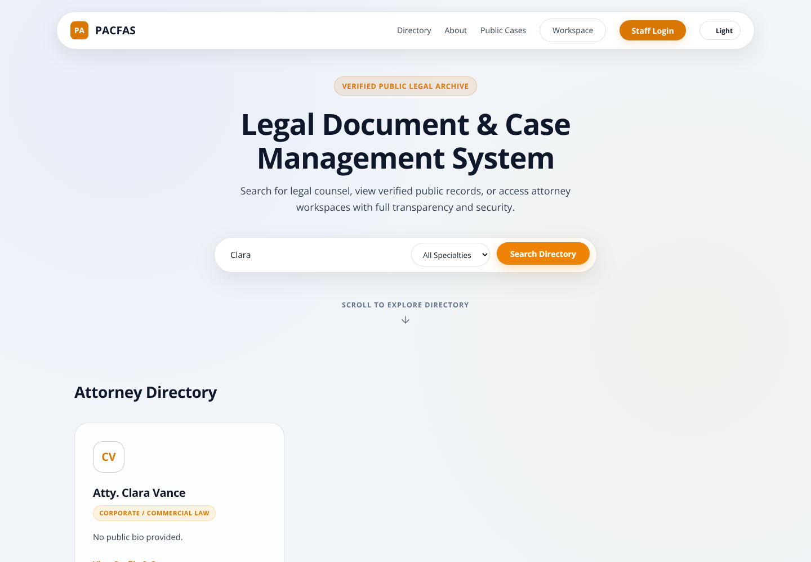

# 3. Sign in and sign out

1. On the home page, select Staff Login.
2. Enter the email address and password supplied by your office administrator.
3. Submit the login form. A successful office login opens the workspace dashboard.
4. If Invalid credentials appears, recheck your email and password. An inactive account also cannot log in; contact the administrator.

The screenshot illustrates validation feedback, not a password you should copy. No shared production login is supplied by this manual.

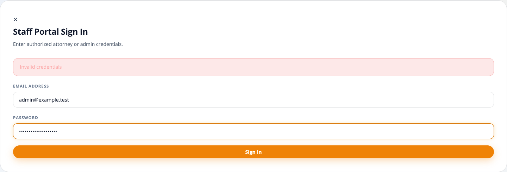

Select Logout when finished, especially on a shared computer. Logout clears the browser's saved login token and returns to the home page. Closing a tab is not the same as selecting Logout. Follow office policy for securing any files already downloaded to the device.

If a session expires, sign in again. Public/client accounts may authenticate but still be denied private workspace requests; authentication does not automatically grant office permissions.

# 4. Dashboard and case creation

The dashboard shows Active Cases, Pending Cases and Total Documents for the case list currently loaded. Filters affect the displayed list and these counts. Pending Cases is not a count of scheduled hearings.

Search by case title or description. Use status, category and priority filters to narrow the list. If no cases appear, clear the search and return filters to All before assuming a record is missing.

Select Open File in a row to view its case details.

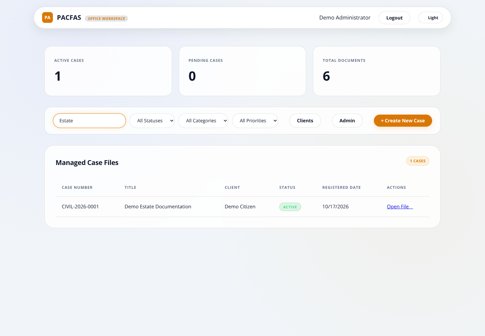

## Create a new case — administrator or staff

1. Select + Create New Case.
2. Choose the category, such as Civil.
3. Enter a clear case title and select a status.
4. Add a description if needed. Avoid unnecessary personal or sensitive information.
5. Review the generated-number preview, then submit the form.
6. Find the new case in the table and select Open File.

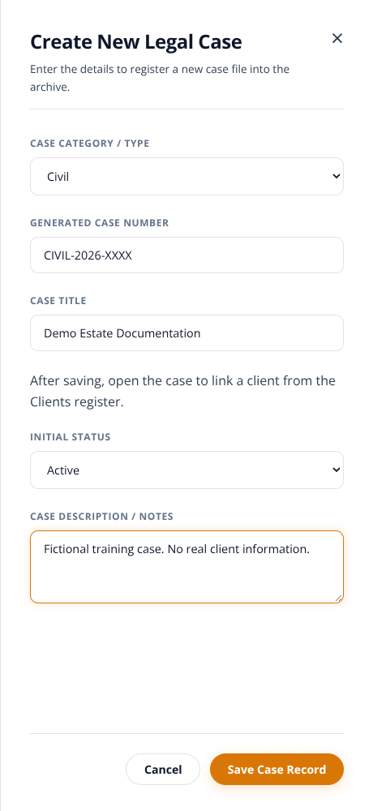

A number such as CIVIL-2026-0001 contains the category code, creation year and padded database ID. The database assigns the numeric ID after saving. It is not a court-issued docket number, a category-specific counter or a promise of gap-free numbering.

Clients are linked after the case has been saved. The creation drawer does not create a client profile or store a free-text client name. Use the Clients register and the case's client-link form instead.

The table's Registered Date is the system registration date. Do not treat it as proof of the legal filing date.

# 5. Client profiles and case links

## Create a client — administrator or staff

1. Open Clients from the dashboard.
2. Enter first name, last name and birth date.
3. Add email, contact number, city and region where appropriate.
4. Submit the form and confirm that the profile appears in Client Profiles.

Creating a profile does not provide the client with a usable portal login or grant access to private case records.

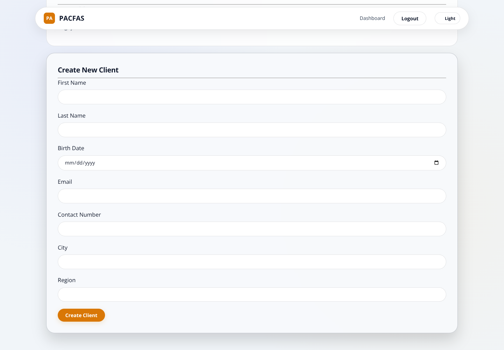

## Link an existing client to a case

1. Open the case from the dashboard.
2. In its client-link form, select the existing client.
3. Enter the role on this case, such as Petitioner or Defendant.
4. Submit, then confirm the client appears in the linked-clients section.
5. Check Case Information and the dashboard client column. They show linked client names, not the username of the person who created the case.

Do not create another profile merely to link the same person to another case. Check existing profiles first. Duplicate-profile and duplicate-link prevention are not guaranteed by this interface.

# 6. Assign legal counsel

Administrator or staff:

1. Open the case.
2. Select an active attorney from the counsel-assignment list.
3. Enter Role on Case, for example Lead Counsel.
4. Submit and confirm the attorney appears in the assigned-counsel section.

An inactive attorney cannot be newly assigned. Attorney/public/client accounts cannot change counsel assignments through the protected route.

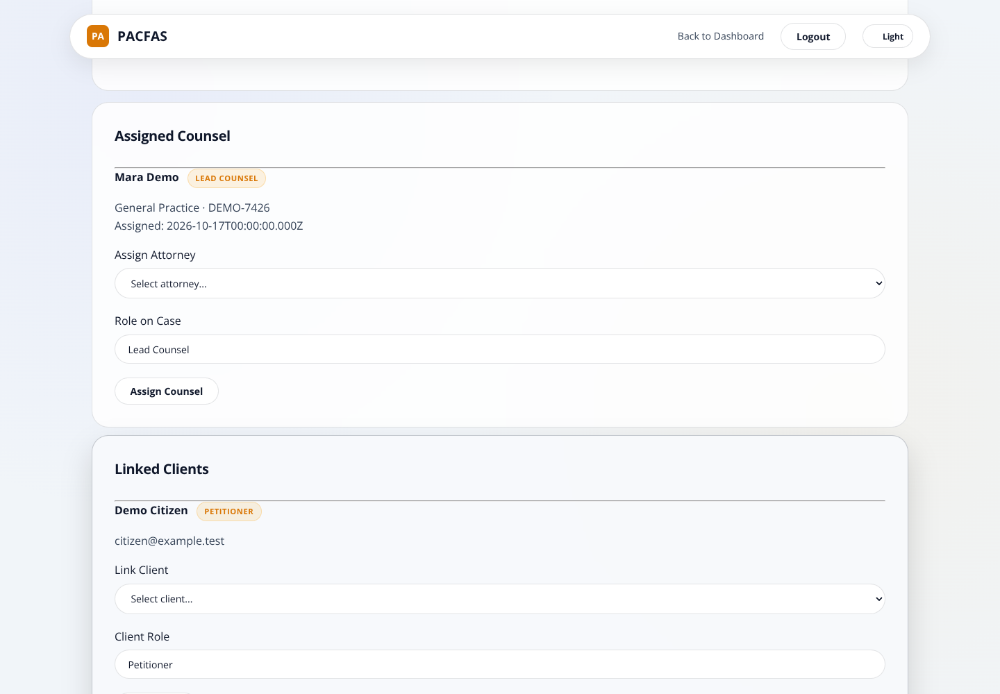

Check assignments before scheduling: hearing conflict checks use the attorneys associated with the case. This application is not a substitute for your office calendar or a court's official notice.

# 7. Schedule hearings and resolve conflicts

## Add a hearing

1. Open the case and select + Add Hearing.
2. Enter the hearing type/title, up to 50 characters.
3. Choose the date and time.
4. Enter the court/venue and optional notes.
5. Select Save Hearing.
6. Confirm the saved hearing appears in Scheduled Hearings after the case view reloads.

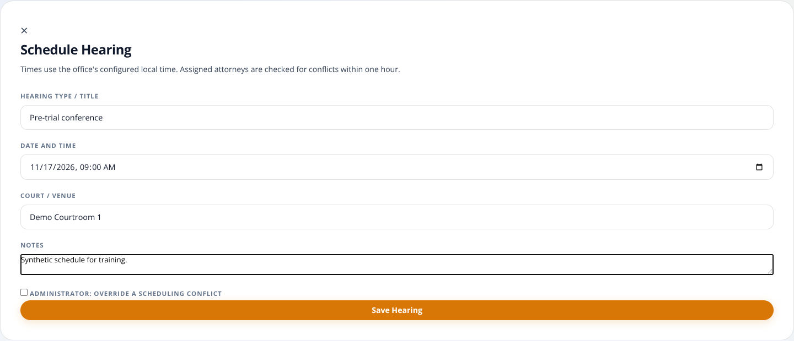

Use the office's agreed local time. Confirm the server/office timezone with the administrator, especially if working from another location. The interface does not offer an explicit timezone selector.

## When the system reports a conflict

The creation check looks for another hearing within one hour of the requested start time for assigned counsel. The boundary times are included. It does not calculate actual duration or travel time.

1. Read the scheduling-conflict message.
2. Prefer another time and check the office's actual schedule.
3. Only an administrator can deliberately select the override checkbox and resubmit.
4. Staff and attorneys cannot override by checking a hidden control or changing a request.

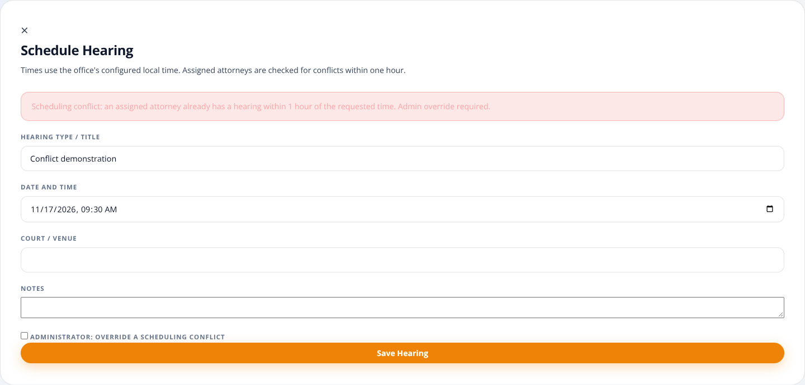

The browser flow currently adds hearings; it does not provide a full edit/reschedule/cancel interface. Update-time conflict prevention and fully serialized simultaneous hearing scheduling are not certified safeguards. Arrange changes through your authorized office process and independently recheck conflicts.

# 8. Upload documents and read extracted text

Supported uploads: PDF, PNG, JPEG/JPG and TIFF, up to 25 MiB per file (the interface labels this 25 MB). File contents must match the reported supported type. A matching signature does not prove the whole file is valid or malware-free.

1. Open the correct case and check its title before selecting a file.
2. Select + Upload Document.
3. Enter a meaningful document title/tag.
4. Choose a supported file and submit Upload & Extract Text.
5. Confirm a document card appears in the archive.
6. Wait for extraction to finish, then expand View Extracted OCR Text.

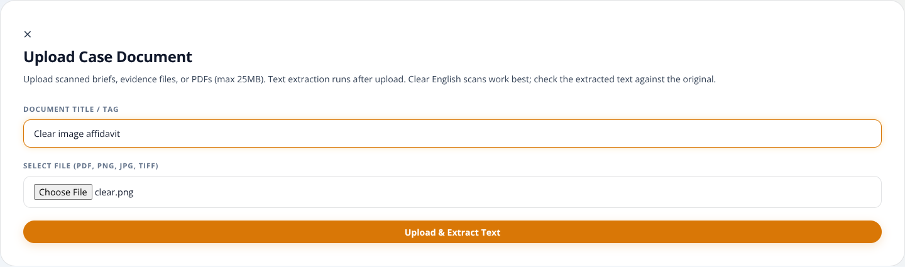

## Understand extraction status

| Status | Meaning | Your action |
| --- | --- | --- |
| PENDING | File and metadata were saved; extraction is waiting to start | Wait or use Refresh status |
| PROCESSING | Recognition/extraction is running | Wait; avoid duplicate uploads |
| COMPLETED | Nonempty extracted text was stored | Open the text and compare it with the original |
| FAILED | Extraction did not produce usable text or encountered an error | Check the source file; see the retry section |

Saving a file and recognizing its text are separate operations. A successful upload does not guarantee successful OCR. The page checks pending work automatically for about two minutes. Select Refresh status or reload the case if needed.

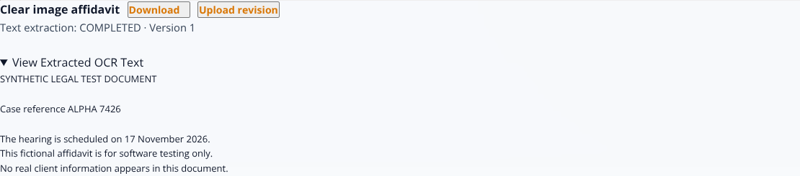

For text-based PDFs, the application first reads embedded text. For low-text/scanned PDFs, it renders pages and performs English OCR. Recognized words can contain mistakes, particularly in names, dates, amounts, handwriting, skewed pages or poor scans. COMPLETED means text exists, not that it is legally accurate or complete.

Use clear, upright scans with good contrast. Review every important extracted field against the original document. Mixed text/image PDFs can require additional review because the current low-text fallback rule may not OCR every image-only section.

# 9. Revisions and downloads

## Upload a new revision

1. Find the correct document card.
2. Select Upload revision, not + Upload Document.
3. Select the replacement file and submit the upload form. The title field remains part of the form, but the existing document's title is retained for revisions.
4. Confirm the card shows the next version number and wait for its extraction status.
5. Expand extracted text to review the current revision.

The document ID stays the same; the version number increases. Creating a new logical document instead produces a separate document card. The browser does not provide a complete history-selection interface, although the backend retains version records.

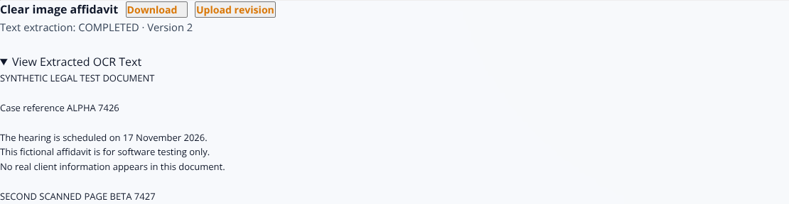

## Download the current file

Select Download on the card. The browser makes an authenticated request and downloads the file for the current version. Confirm its extension and save it only to an approved location.

During validation, the downloaded scanned-PDF bytes matched the uploaded current revision exactly. This verifies the tested path; users should still confirm they opened the correct case, document and version.

If the browser blocks the download or the session expires, check browser permissions and sign in again. Never work around a failed download by exposing the raw uploads folder.

# 10. Failed OCR and retry

A blank image or corrupt PDF can be stored successfully and then show FAILED. This is expected failure handling; it is not a successful recognition result.

1. Read the message on the document card.
2. Download/check the original if available. Is it blank, damaged, too dark or in an unsupported language?
3. If the original is unchanged and the problem may have been temporary, select Retry extraction.
4. Wait for the new status. Only failed extractions can be retried.
5. If the source itself needs improvement, create a better scan and upload it as a revision instead of repeatedly retrying the same unusable file.

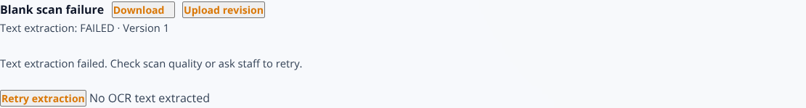

A retry cannot repair a blank page. Recognition of corrupt or protected documents may still fail. Escalate recurring failures to the administrator; do not assume the legal archive is complete because files are listed.

If jobs remain PENDING/PROCESSING after a server restart, the administrator must use the offline interrupted-job procedure described in the deployment notes. Ordinary users should not run maintenance commands.

# 11. Administrator: create an attorney account

1. Open Admin from the dashboard.
2. Enter the attorney's first name, last name and email address.
3. Optionally enter a username; otherwise the application derives one from the email.
4. Supply a unique initial password of at least 12 characters. There is no shared default password in this updated flow.
5. Select a valid specialization ID and enter the bar number if appropriate. Specialization IDs must correspond to the configured lookup table; this form does not yet provide a named specialty picker.
6. Submit and confirm the attorney appears in the directory/list.
7. Deliver account details through an approved private channel, not in a case description or public note.

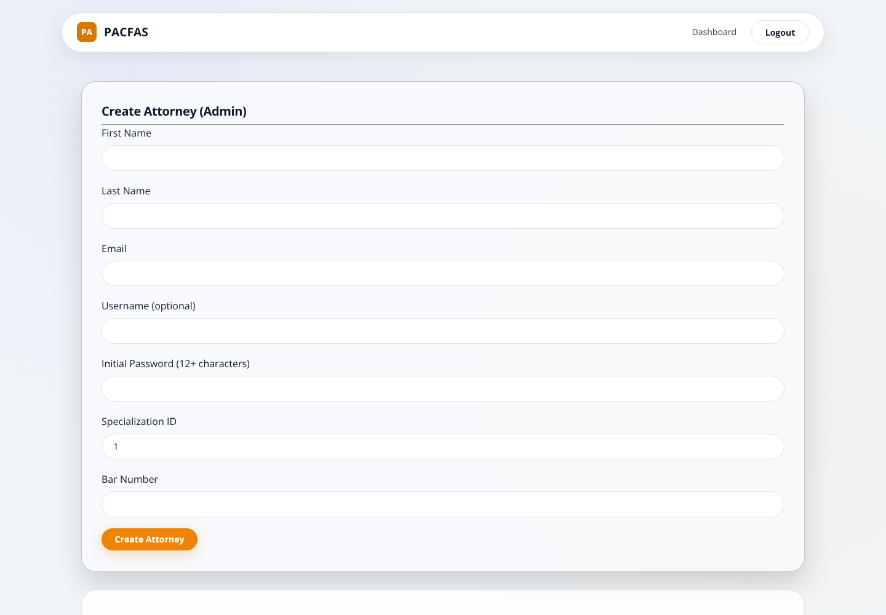

This page creates attorney accounts. It does not provide a complete user-administration, password-reset or role-management interface. Ask the authorized system administrator to perform those operations through the office's established administrative process.

# 12. Mobile use and troubleshooting

At narrow widths, navigation and filters wrap. Scroll down to reach case controls; swipe horizontally within the case table to see columns that do not fit. The create-case drawer and dialogs scroll when necessary. Do not assume content is missing because it lies below the initial viewport.

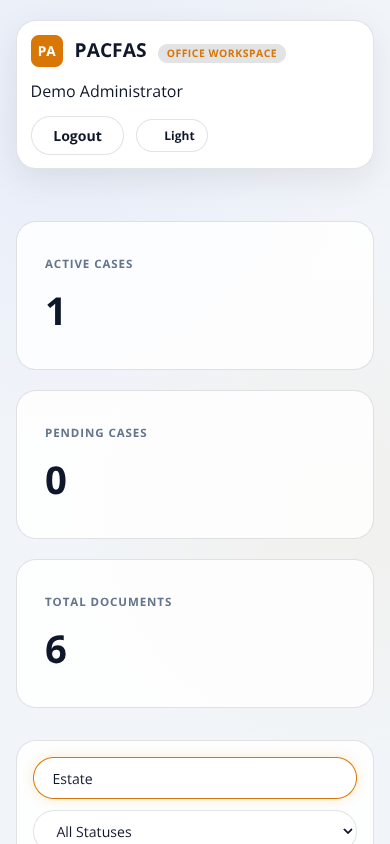

| Symptom | What to do |
| --- | --- |
| No matching cases | Clear search and reset filters to All; verify you have office access |
| A client name is missing | Create/select the client in Clients, then link that profile to the case |
| Permission denied | Check account role with the administrator; signing in does not grant all roles |
| Session expired or download denied | Sign in again; do not share or manually paste tokens |
| Upload rejected | Check supported type, content, file size and whether the file opens locally |
| OCR stays pending | Refresh; ask the administrator whether the service restarted |
| OCR fails repeatedly | Improve the scan or replace a corrupt file; upload a revision |
| Database unavailable | Contact the administrator; reloading will not start a stopped database |

Never include real client documents, passwords or tokens when reporting a bug. Supply the action, time, safe record identifier and a sanitized error message instead.

# 13. Administrator setup and operational limits

This is a user guide, not a replacement for deployment instructions. Before using the updated application on an existing installation:

1. Back up the database and document directory. Stop all app/worker instances for schema maintenance.
2. Follow docs/Repair_Validation.md for migrations/001_document_ocr.sql.
3. Apply migrations/002_private_case_defaults.sql and review existing public records. New defaults do not alter older publication decisions.
4. Use the locked dependencies and a supported Node.js version. Test /ready, not only /health: a running web process can still have an unavailable database.
5. Ensure English Tesseract language data is available. For offline deployment, set TESSDATA_PATH to the local folder containing eng.traineddata. Do not point it at an untrusted source.
6. DB_SOCKET optionally connects to a local Unix-socket database; ordinary host/port configuration remains available.
7. Review existing accounts and secrets. Ignore rules do not remove already-tracked secrets from Git history.

OCR runs in the application process, not a durable queue. Stop every worker before using the documented interrupted-job recovery command. Do not run recovery alongside active recognition jobs. Recognition concurrency, resource limits, disaster recovery, malware scanning and high-load operation require additional production planning.

## Validation behind this guide

The final test run used Chromium 153, MariaDB 10.8.3 and real Tesseract English recognition. Twenty browser/OCR checks passed with no uncaught browser JavaScript errors. Fifty-four regression checks passed. The database integration suite passed nine subtests plus its parent test. Screenshots were captured during the final browser run, using only synthetic records.

The browser checks cover the documented primary paths, selected failures, role restrictions, a two-page scanned PDF, PNG/JPEG/TIFF recognition, text PDF extraction, revision-byte downloads and a 390-pixel dashboard smoke check. They are not a claim that every browser, every device, every legal document or every production configuration has been certified. Hearing rescheduling, broad concurrency/load, complete accessibility, full account administration and per-client portal isolation remain outside this sign-off.

For details and rerun instructions, see docs/Browser_OCR_Validation.md and docs/Browser_OCR_Results.json.
